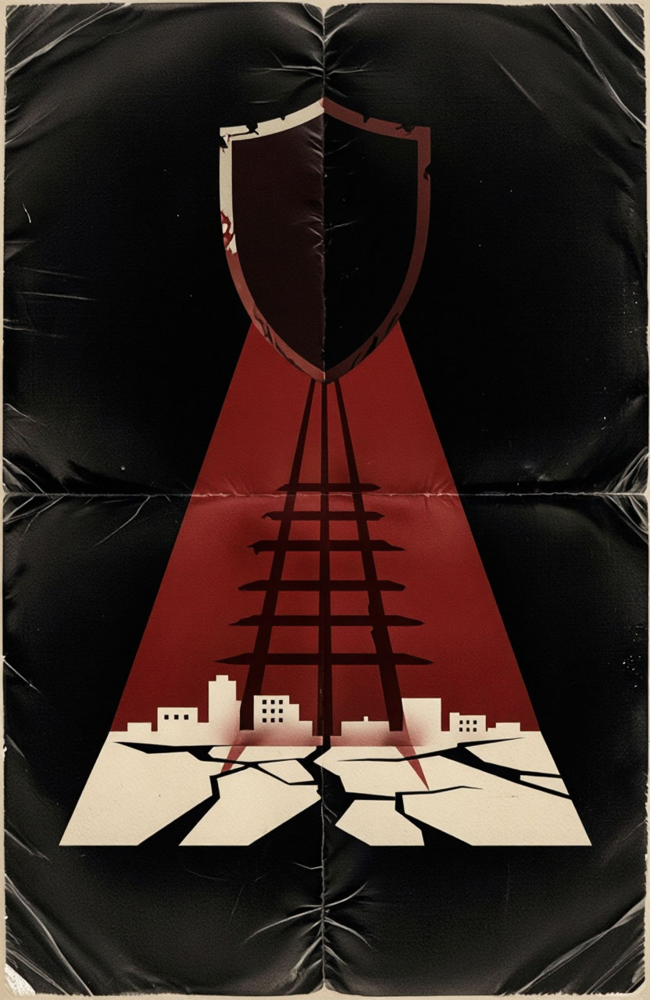
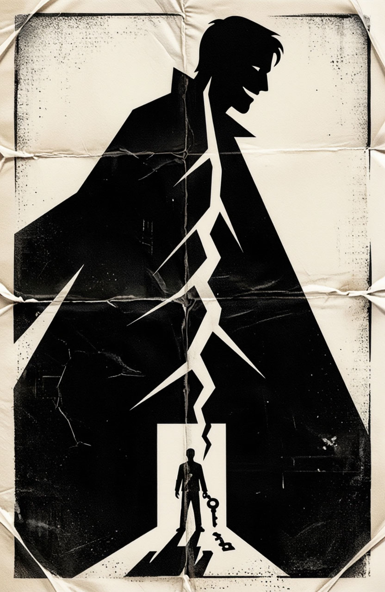
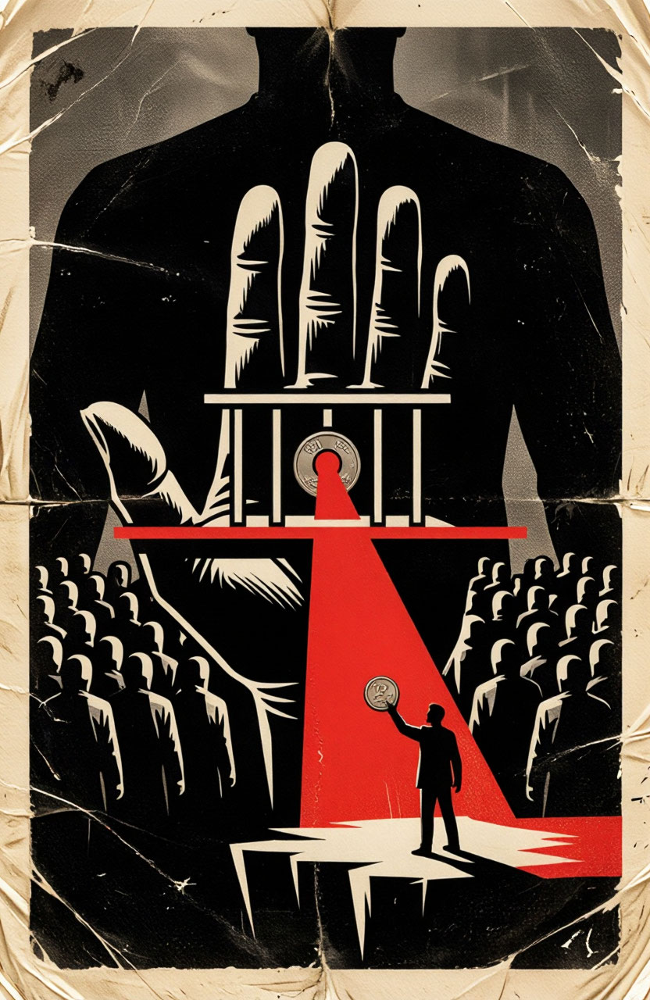
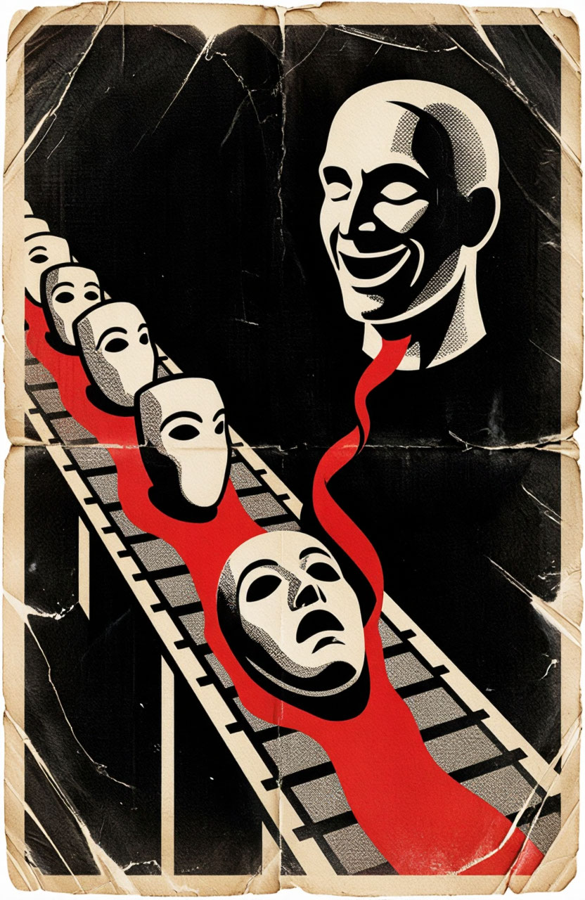
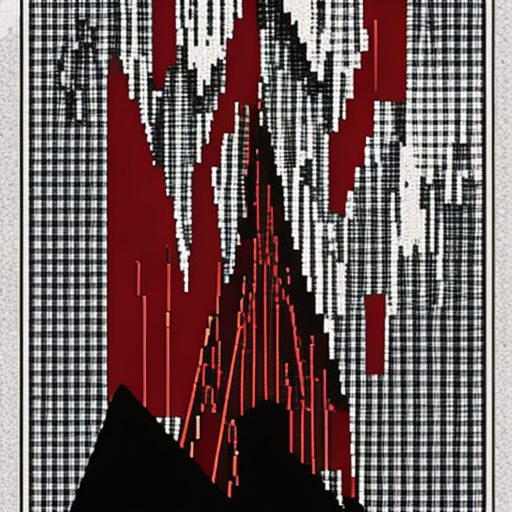

# Отчёт по работе «АХ: Агент-художник»

## Выполнили

**Копылов Михаил Юрьевич, М8О-206СВ-25.**
при использовании
**Codex**

Тема коллекции: **«Супергерои — проклятие»**.

## Мотивирующий абзац (Project Statement)

Четыре сатирических плаката рассматривают супергероя как источник контроля,
сопутствующего ущерба, коммерческой зависимости и массового поклонения.
Обещание спасения становится ловушкой: щит отбрасывает решётку, плащ превращается
в трещину, рука помощи требует оплату, культ выпускается на конвейере.
Визуальный ориентир — The Boys:
контраст чёрного и красного, потёртая кремовая бумага, монументальные формы.

Особенность коллекции — четыре конкретные
метафоры превращения защиты в угрозу и возможность проверить, как замечания VLM
изменили изображения.

## Использование ИИ

Пользователь выбрал тему и референс, предоставил доступ к Yandex AI Studio.
Codex обновил исходный код, промпты, ноутбук, галерею и отчёт, выполнил реальные
вызовы моделей и проверил полученные артефакты пользователь. Исходный запрос и художественное
решение сохранены в [docs/IDEA.md](docs/IDEA.md). Начальные запросы автора
и указатели на системные промпты собраны в [docs/PROMPTS.md](docs/PROMPTS.md).
[Референс](docs/reference-poster.png).

| Участник | Модель | Функция |
|---|---|---|
| Куратор | deepseek-v4.1-flash/latest | Метафора и уточнение замысла, Responses API |
| Художник | aliceai-llm/latest | Обсуждение, промпты обеих версий, Responses API |
| Визуальный критик | qwen3.6-35b-a3b | Оценка PNG и сравнение версий, Chat Completions |
| Облачный генератор | aliceai-image-art-3.0/latest | Изображения, Images API |
| Локальный генератор | stabilityai/sd-turbo | Дополнительная интерпретация, Diffusers |

Куратор и художник имеют раздельную историю. Критик получает PNG в Base64;
каждая оценка самостоятельна, а сравнительный запрос содержит обе картинки.
В JSON сохранены реальные входы, системные инструкции, ответы, идентификаторы
ответов, параметры и длительности.

Контур ограничен двумя версиями. Выбор первой разрешён, порядок предъявления
фиксирован. Позиционный эффект и устойчивость оценок отдельно не измерялись.

## Результаты

### Ход выполнения

1. Настроено проектное окружение командой `uv sync --locked`. Доступ к Yandex
   AI Studio читается из `.env` через `load_dotenv`.
2. В `IDEA` задана общая эстетика, в `ARTWORKS` — четыре тематических замысла.
   Куратор и художник обмениваются предложениями через Responses API.
3. Для каждой работы выполнены восемь стадий: замысел куратора → предложение
   художника → согласование → промпт v1 → критика v1 → промпт v2 → критика v2 →
   сравнительный выбор. После промптов выполняется вызов Images API.
   Ответ критика передаётся художнику как вход для доработки.
4. Для первого замысла дополнительно запущена SD-Turbo с весами Hugging Face.

### Коллекция

### 1. Под защитой

Щит нависает над пустым городом; красный конус и чёрная решётка связывают защиту
с ограничением свободы. В финале хорошо читаются щит, город и угроза.
При этом решётка напоминает лестницу или рельсы, а трещины на земле добавляют
отдельный мотив разрушения. Критик называет щит круглым, хотя он заострён:
даже при доступе к пикселям описание модели требует проверки человеком.

[Диалог](outputs/01-surveillance/DIALOGUE.md) · [Версия 1](outputs/01-surveillance/v1.png).

### 2. Цена спасения

Огромная фигура героя доминирует над человеком у пустого дверного проёма.
Плащ и трещина образуют центральную вертикаль. Финал почти полностью чёрно-кремовый:
заданный красный акцент не сохранён. Жилой квартал тоже не читается явно,
поэтому мотив утраты дома поддерживается прежде всего ключом и проёмом.
Критик предпочёл более собранную композицию второй версии, несмотря на снижение
собственной оценки соответствия замыслу с 8 до 7.

Фрагмент обратной связи из [05-critique-v1.json](outputs/02-collateral/05-critique-v1.json):

> Трещина разветвляется слишком хаотично — теряется строгая вертикаль, которая должна вести глаз к проёму.

В ответ художник включил в `changes`:

> упростить трещину до одной строгой вертикальной линии, ведущей прямо к проёму

Этот ответ и новый промпт сохранены в
[06-prompt-v2.json](outputs/02-collateral/06-prompt-v2.json).

[Диалог](outputs/02-collateral/DIALOGUE.md) · [Версия 1](outputs/02-collateral/v1.png).

### 3. Герой по подписке

Маленький человек с монетой стоит у края, над ним — огромная ладонь и платёжный
барьер. Красная перекладина делает условность помощи заметной.
Повторяющиеся фигуры по сторонам читаются скорее как зрители, чем как корпорация.
Критик приписывает монете узнаваемый рельефный портрет; это его интерпретация,
а не установленная идентичность. Композиция остаётся сложнее исходной идеи
единственного барьера между человеком и спасением.

[Диалог](outputs/03-subscription/DIALOGUE.md) · [Версия 1](outputs/03-subscription/v1.png).

### 4. Культ на конвейере

Улыбающийся бюст господствует над конвейером одинаковых масок. Одна маска отличается
выражением испуга, поэтому мотив массового производства и сбоя образа читается.
Однако требуемая перевёрнутая пустая маска не получилась. Критик сначала утверждает,
что видит её внутреннюю сторону, а затем сам отмечает испуганное лицо: в ответе есть
противоречие. Его замечание об отсутствии заломов тоже спорно — складки и рваные
края на изображении хорошо видны. Эти суждения сохранены без исправления задним числом.

[Диалог](outputs/04-cult/DIALOGUE.md) · [Версия 1](outputs/04-cult/v1.png).

### Локальная модель

Для «Под защитой» выполнена локальная генерация `stabilityai/sd-turbo`:
Apple MPS, FP16, 512 × 512, 4 шага, `guidance_scale=0`, seed 42.
Revision весов: `b261bac6fd2cf515557d5d0707481eafa0485ec2`.
Английский промпт художника содержит 48 токенов и укладывается в лимит без
дополнительного сокращения. Параметры и хеш — в [sd-turbo.json](outputs/01-surveillance/sd-turbo.json).

Получилась абстрактная красно-чёрная структура с сеткой, но узнаваемый щит и
отношение «щит — город — тень» потеряны.

### Ошибки и изменение концепций

Images API отклонил два исходных сюжета: гигантского героя с лучами взгляда
и сцену с подростковыми силуэтами, копирующими героя. Причина в ответе API
не конкретизирована. Разработаны другие композиции: предметная аллегория щита
и фабрика масок. Исходные диалоги и сообщения об отказе сохранены в
`outputs/01-surveillance/rejected-concept/` и `outputs/04-cult/rejected-concept/`.

DeepSeek однажды добавил лишнее поле, а Alice вернула JSON Schema с вложенными
значениями вместо экземпляра ответа. Локальная валидация Pydantic отклонила
такие ответы; невалидные данные сохранены в `failed-*.json`. Инструкция уточнена:
возвращать заполненные поля непосредственно в корне JSON. Готовые стадии
повторно не генерировались. Это реальные рабочие сбои, а не часть художественного диалога.

### Галерея и сохранение материалов

Галерея опубликована на [GitHub Pages](https://mikhail-cwc.github.io/prompt-eng-homework/).
На сайте представлены четыре работы, переключение версий изображений и диалоги агентов.

## Выводы

1. На практике разобран способ координации LLM: роли имеют разные инструкции
   и историю, а результаты одной роли явно передаются другой. Польза разделения —
   прослеживаемость решения от метафоры до промпта и изображения.
2. Реализована визуальная обратная связь по самим PNG. На примере трещины видно,
   как критика превращается в правку промпта, но исчезновение красного цвета
   показывает, что исправление одной детали может сопровождаться потерей другой.
3. Освоена проверка структурированных ответов и возобновление по сохранённым
   стадиям. Невалидный JSON и отказ генератора требуют обработки; их нельзя
   считать успешно выполненными шагами.
4. Локальный запуск открытых весов дал практический опыт работы с Diffusers,
   seed и ограничением длины промпта. SD-Turbo сохранила цвета, но потеряла щит:
   для оценки следования замыслу нужно смотреть на изображение, а не на факт запуска.
5. Работа полезна как проверяемый эксперимент с многоагентной генерацией.
   Противоречивые описания критика показывают необходимость человеческой проверки.
   Превосходство над одним агентом здесь не измерялось.
